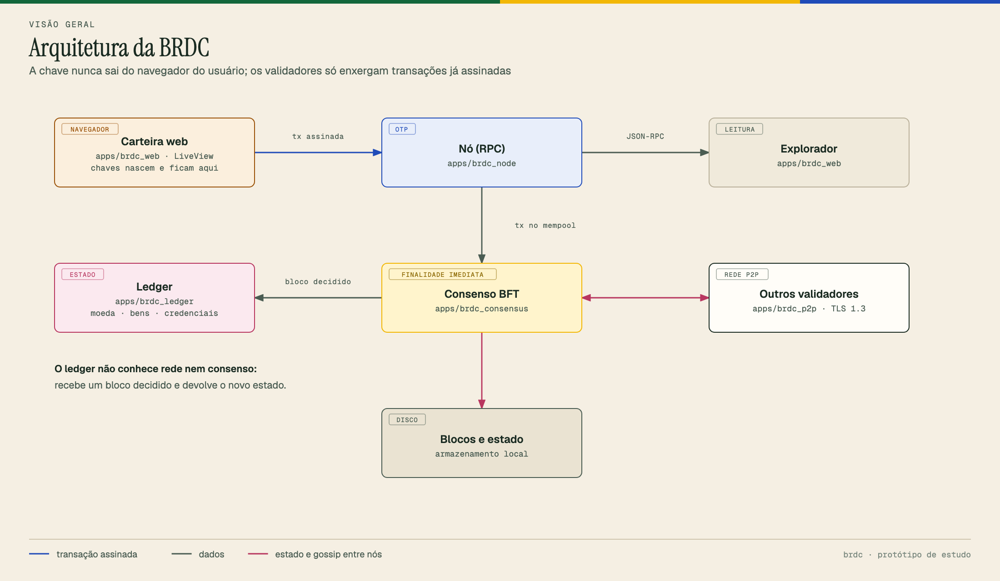

# BRDC · Brazilian Decentralized Coin

Uma **stablecoin brasileira** (1 BRDC = 1 BRL) numa blockchain própria em **Elixir**, com **contratos nativos** de propriedade, credenciais (CNH, identificação, casamento, divórcio…) e contratos entre partes, uma rede **P2P** de validadores e uma **carteira web não custodial**. Projeto de estudo: sem auditoria, sem validade jurídica, sem integração bancária real.

> **Estado atual: Fase 6 em andamento (carteira de autocustódia: identidade visual escura, criptografia do navegador, cofre cifrado, telas de criar, importar e destravar, **saldo e envio de BRDC** contra um nó local de um validador; **contratos entre partes** (criar, aceitar e operar, com prévia do dinheiro); faltam bens, credenciais, assinatura coletiva e o nó com vários validadores), Fase 5 pronta (no ledger: bens com órgão, escrow, veto e gravames; credenciais com janela de contestação, validade, revogação, casamento e divórcio; contratos entre partes de compra e venda, aluguel e empréstimo), Fase 4 pronta (canal TLS 1.3 mútuo, limites, banimento, descoberta de pares, porta pública, `keygen` e gênese), Fase 3 com o motor de consenso pronto (BFT, simulado com falhas), Fase 2 pronta (ledger em memória: transferência, mint e burn por M-de-N, atestado de reserva, taxas, blocos atômicos).** A Fase 1 também. `brdc_crypto` tem hash etiquetado, Ed25519, BIP-39 com passphrase, SLIP-10, endereços `brdc1…` e codificação determinística, com vetores oficiais conferidos também em JavaScript. **Ainda não há rede P2P, nó rodando nem carteira web**: a moeda e o consenso existem como bibliotecas testadas em memória e por simulação, e o resto chega nas fases seguintes ([roteiro](docs/PHASES.md)).



## O que a BRDC vai ser

- **Moeda estável em reais.** Emissores autorizados criam (mint) BRDC quando recebem reais e destroem (burn) quando devolvem; as reservas atestadas ficam publicadas na chain. [ADR-0002](docs/adr/0002-reserve-backed-by-reais-and-issuers.md)
- **Consenso BFT** entre validadores autorizados, com finalidade imediata: um bloco decidido não é desfeito. [ADR-0003](docs/adr/0003-bft-consensus-with-permissioned-validators.md)
- **Contratos nativos** (módulos Elixir revisados + modelos declarativos de contrato), sem máquina virtual. [ADR-0004](docs/adr/0004-native-contracts-and-declarative-templates.md)
- **Carteira web de autocustódia (não custodial):** as chaves nascem e ficam no navegador (BIP-39, passphrase como 25ª palavra); o servidor nunca as vê. [ADR-0005](docs/adr/0005-keys-ed25519-slip10-bip39.md), [ADR-0006](docs/adr/0006-web-wallet-liveview-and-browser-crypto.md)
- **Rede P2P** em TCP com TLS 1.3 mútuo, autenticada pela chave de cada validador. [ADR-0015](docs/adr/0015-p2p-over-mutual-tls-1-3.md) · [ADR-0007](docs/adr/0007-p2p-tcp-with-noise.md)
- **Sem congelamento de contas** (BRDC sem censura), com os riscos assumidos e documentados. [ADR-0009](docs/adr/0009-no-freezing-uncensored-brdc.md)

## Mapa dos apps (umbrella)

| App | Papel | Fase |
|---|---|---|
| `brdc_crypto` | hash etiquetado, Ed25519, BIP-39, SLIP-10, passphrase, endereços `brdc1…`, codificação determinística (**pronto**) | 1 |
| `brdc_ledger` (moeda pronta) | contas, transações, blocos, estado e módulos nativos (moeda, bens, credenciais, contratos) | 2 e 5 |
| `brdc_consensus` | motor BFT sem I/O: rodadas, votos, certificado de commit | 3 |
| `brdc_p2p` | canal TLS 1.3 mútuo, portas de pares e pública, limites, descoberta | 4 |
| `brdc_node` | nó (OTP): hoje um validador local com mempool, blocos, porta pública e cliente; depois, vários validadores e disco | 7 |
| `brdc_dev` | **só desenvolvimento:** nó local de teste e as tarefas `mix brdc.fund`, `mix brdc.balance`, `mix brdc.type`, `mix brdc.asset` e `mix brdc.devnet.reset` (o nó local grava os blocos em `net/data`) | 7 |
| `brdc_web` | carteira LiveView (criptografia em JS no navegador; **pronta**: criar, importar, destravar, saldo e envio) e, depois, explorador | 6 |

## Início rápido

```
mix deps.get          # baixa as dependências
mix brdc.check        # formato, credo, compilação sem avisos, testes, JS e docs
mix brdc.docs.check   # confere a documentação
mix brdc              # lista todos os comandos
```

Tudo é `mix` (nada de `make`). **Simular a produção da moeda:** `mix brdc.devnet.up` e depois `mix brdc.simulate issuance` (o banco atesta a reserva, os emissores emitem, a Alice paga a Bob, a Bob resgata e a reserva é reduzida, com as regras conferidas no fim), ou passo a passo com `mix brdc.reserve`, `brdc.mint`, `brdc.burn` e `brdc.supply`. **Rede de teste de vários validadores:** `mix brdc.devnet.up` (cria 4 validadores na primeira vez, cada um num processo, com blocos em disco), `mix brdc.devnet.status`, `mix brdc.devnet.kill 2` (simula uma queda), `mix brdc.devnet.down`; a carteira acha o validador 1 em `127.0.0.1:4545`. Para ver a carteira funcionando (nó local de teste incluído): `mix phx.server` e abra `http://localhost:4000`; para financiar um endereço de teste: `mix brdc.fund brdc1… 100`; a rede de teste **guarda os blocos em disco** (`net/data`) e continua depois de reiniciar; para recomeçar da gênese: `mix brdc.devnet.reset` (com o nó parado).

Para criar uma rede de teste local (as chaves ficam em `net/`, ignorada pelo git; detalhes no [Fluxo 07](docs/flows/07-keygen-and-genesis.md)):

```
mix brdc.keygen v1 && mix brdc.keygen v2 && mix brdc.keygen v3   # validadores
mix brdc.keygen i1 && mix brdc.keygen i2                         # emissores
mix brdc.genesis --chain-id brdc-devnet --validators v1,v2,v3 --issuers i1,i2 --threshold 2
```

Requisitos: Elixir 1.20+ (OTP 29), Node 24 (carteira, Fase 6), Brave (só para gerar os diagramas).

## Por onde começar a ler

1. [Índice da documentação](docs/README.md)
2. [Guia de conceitos](docs/concepts/README.md) (feito para você entender cada peça, com exemplos em Elixir)
3. [Roteiro das fases](docs/PHASES.md) e os [ADRs](docs/adr/README.md)
4. [Arquitetura](docs/ARCHITECTURE.md) e [modelo de ameaças](docs/THREAT-MODEL.md)

## Projeto irmão

O [Teko](../teko) (Rust) é o projeto de estudo de onde vêm os desenhos de BFT, P2P, credenciais e bens. A BRDC os reescreve para Elixir/OTP, com a moeda estável no centro.
