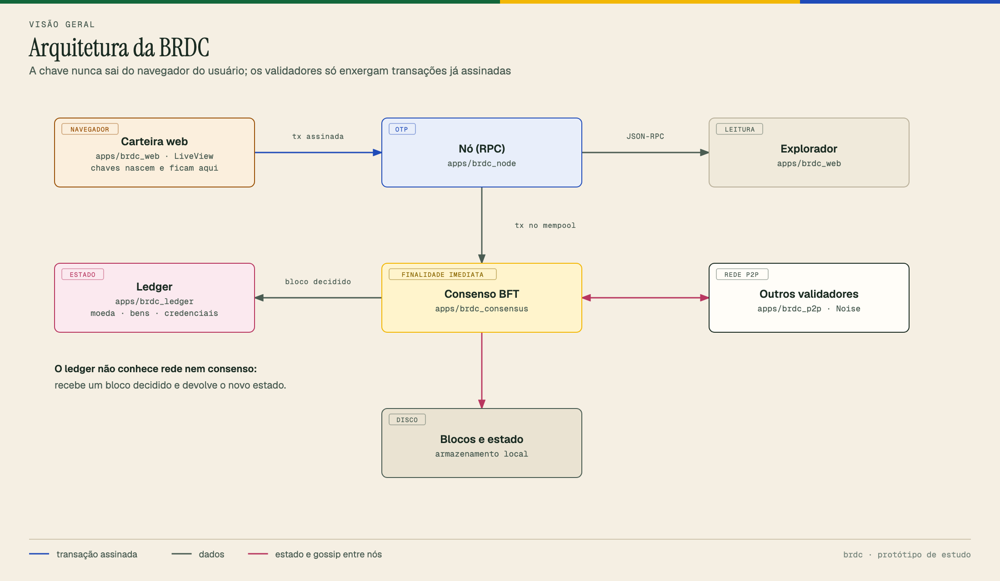

# Arquitetura

## Resumo
A BRDC é uma blockchain **de contas** com consenso **BFT** entre validadores autorizados. O usuário assina uma transação **no navegador**; um nó a recebe, a espalha pela rede P2P, e os validadores, em rodadas, decidem blocos. Cada nó aplica o bloco decidido ao seu **ledger**, que é puro e determinístico, e guarda o novo estado. Os contratos (moeda, bens, credenciais, contratos entre partes) são **módulos nativos** do ledger.

## As camadas e por que são separadas
| Camada | Responsabilidade | Não conhece |
|---|---|---|
| `brdc_crypto` | hash, assinaturas, chaves, endereços | nada acima dela |
| `brdc_ledger` | validar e executar transações, calcular o estado | rede, consenso, relógio, disco |
| `brdc_consensus` | decidir **qual** bloco é o próximo (rodadas, votos, certificado) | o conteúdo das transações |
| `brdc_p2p` | levar mensagens entre nós, com autenticação e limites | consenso, ledger |
| `brdc_node` | juntar tudo: supervisão, mempool, disco, sincronização, RPC | |
| `brdc_web` | carteira (assinatura no navegador) e explorador | chaves dos usuários |

Separar assim traz duas coisas: **testabilidade** (o consenso é uma máquina de estados sem I/O, testada por simulação; o ledger é uma função pura) e **segurança** (um bug de rede não altera o estado, um validador não "julga" transações, só ordena).

## O ciclo de uma transferência
1. A **carteira** (no navegador) monta a transação, assina com a chave do usuário e a envia ao nó por RPC.
2. O **nó** confere a assinatura, o nonce e o saldo para a taxa, e a coloca no **mempool**, espalhando-a aos outros validadores.
3. O **proponente** da rodada monta um bloco com transações do mempool; os validadores votam (prevote, precommit).
4. Com mais de 2/3 dos votos, o bloco é **final** (certificado de commit). Não há fork.
5. Cada nó **executa** o bloco no ledger: debita, credita, cobra a taxa, atualiza a raiz de estado.
6. A carteira vê o novo saldo (tempo real por PubSub) e o explorador mostra quem assinou o bloco.

*(Planejado: este fluxo é entregue nas Fases 2, 3, 4 e 6.)*

## Decisões que moldam tudo
[Lastro e emissores](adr/0002-reserve-backed-by-reais-and-issuers.md) · [consenso BFT](adr/0003-bft-consensus-with-permissioned-validators.md) · [contratos nativos](adr/0004-native-contracts-and-declarative-templates.md) · [chaves](adr/0005-keys-ed25519-slip10-bip39.md) · [carteira web](adr/0006-web-wallet-liveview-and-browser-crypto.md) · [P2P](adr/0007-p2p-tcp-with-noise.md) · [taxas](adr/0008-fees-paid-in-brdc.md) · [sem congelamento](adr/0009-no-freezing-uncensored-brdc.md).

## Onde está no código
Hoje só os esqueletos em `apps/*/lib/*.ex`, cada um com o `@moduledoc` do papel do app. O código real entra a partir da Fase 1.

## Limites honestos
Protótipo de estudo: sem auditoria, sem integração bancária, sem validade jurídica. O desenho fica sujeito às decisões pendentes listadas nos [ADRs](adr/README.md).
