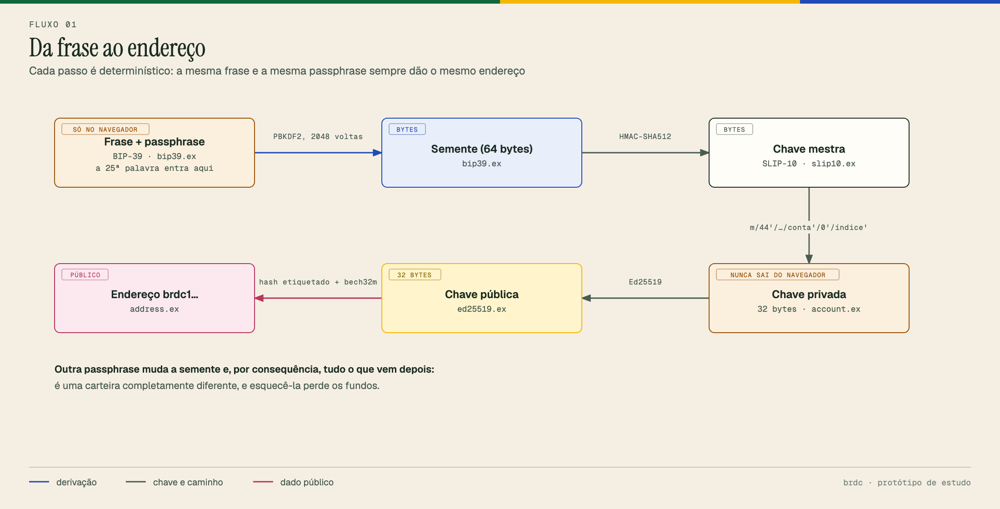

# Como ler o código da Fase 1 (`brdc_crypto`)

Esta página é um **mapa de leitura**: em que ordem abrir os arquivos, o que cada um faz e como rodar os exemplos. Pré-requisito: [Hash e assinatura](02-hash-and-signature.md) e [Carteira HD e passphrase](03-hd-wallet-and-passphrase.md).

## Ordem sugerida
Tudo está em `apps/brdc_crypto/lib/brdc_crypto/`. Cada módulo é pequeno e só depende dos anteriores.

| # | Arquivo | O que faz | Em uma frase |
|---|---|---|---|
| 1 | `hash.ex` | SHA3-256 e **hash etiquetado** | `SHA3-256(tamanho_da_etiqueta ‖ etiqueta ‖ dados)`: o "carimbo de domínio" impede confundir o hash de uma transação com o de um bloco |
| 2 | `ed25519.ex` | assinar e conferir | usa o `:crypto` do OTP; `verify` devolve `false` para lixo, nunca levanta exceção |
| 3 | `bech32m.ex` | texto com prefixo legível e checksum | `brdc1…`: se você errar uma letra, o checksum acusa |
| 4 | `address.ex` | endereço | `bech32m("brdc", hash_etiquetado("brdc/addr", chave_pública))` |
| 5 | `bip39.ex` | frase de 12 a 24 palavras ↔ entropia ↔ semente | a **passphrase** (25ª palavra) entra só na conversão frase → semente |
| 6 | `slip10.ex` | derivação de chaves filhas | só caminhos **endurecidos** (`'`), como exige o Ed25519 |
| 7 | `account.ex` | junta tudo: frase + passphrase + conta + índice → chave e endereço | `inspect` mostra `[REDACTED]` no lugar da semente |
| 8 | `encoding.ex` | codificação determinística ([ADR-0011](../adr/0011-deterministic-encoding-and-tagged-hash.md)) | campos em ordem fixa, inteiros big-endian, bytes com prefixo de tamanho de 4 bytes |

A lista de 2048 palavras fica em `priv/bip39_english.txt` e é lida **em tempo de compilação**.

## O caminho completo, de ponta a ponta


O fluxo com diagrama está em [Fluxo 01: da frase ao endereço](../flows/01-phrase-to-address.md).

## Rode você mesmo (`iex -S mix`)
Estes trechos foram executados de verdade:

```elixir
m = "abandon abandon abandon abandon abandon abandon abandon abandon abandon abandon abandon about"
BrdcCrypto.Bip39.valid?(m)                     # => true
{:ok, a} = BrdcCrypto.Account.from_mnemonic(m)
a.address                                      # => "brdc18yk04cx53nt3yla50snpt6z2ffy4py0u98ynacv7kuahw5eq6f0qn7cldk"
{:ok, b} = BrdcCrypto.Account.from_mnemonic(m, "segredo")
b.address                                      # => "brdc10q0nqnn4wxx9y9dff9eg7sv64nwy0rcc3sxp532qwvcs5e9zlgdsj6nye3"  (outra carteira!)
inspect(a)                                     # => "#BrdcCrypto.Account<brdc18yk…, seed: [REDACTED]>"
sig = BrdcCrypto.Account.sign(a, "oi")
BrdcCrypto.Ed25519.verify("oi", sig, a.public_key)   # => true
```

## Como o JS concorda com o Elixir
`vectors/crypto.json` guarda resultados conhecidos (semente, chave pública, endereço, SLIP-10, hash etiquetado). O Elixir os confere em `shared_vectors_test.exs` e o JavaScript em `tools/js/verify-vectors.mjs` (`mix brdc.js.test`), com implementação **independente** (só Node, sem bibliotecas). Se uma das pontas mudar o formato, a outra quebra: é o que impede a carteira web e o nó de divergirem ([T11](../THREAT-MODEL.md)).

## Limites honestos desta fase
- A BEAM não zera a memória: a chave privada em `Account` fica na memória até o coletor de lixo agir. **No produto quem deriva é o navegador**; este módulo é para testes e ferramentas de desenvolvimento.
- O `coin_type` `1112687683` não está registrado no SLIP-44.
- A biblioteca final de Ed25519 do navegador ainda é a decisão pendente **P6**; o Node é só a referência do teste.
- `Bech32m`, `Bip39` e `Slip10` são implementações próprias, validadas por vetores oficiais, **sem auditoria externa**.
