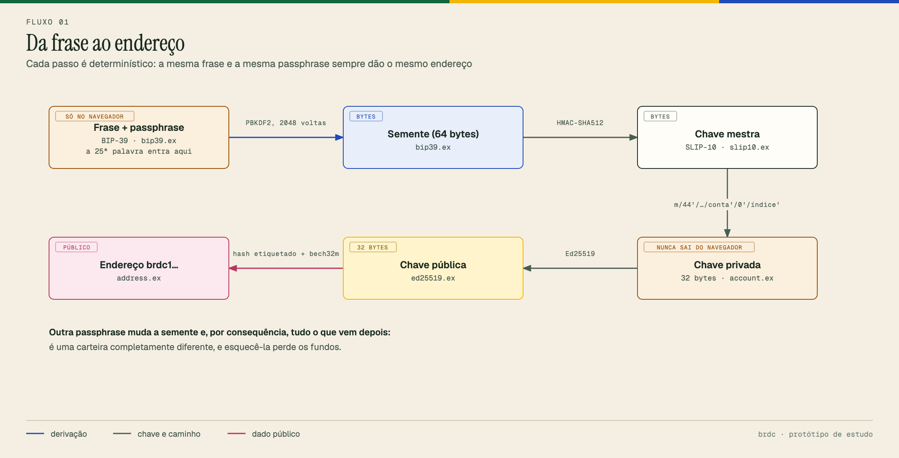

# Fluxo 01 — Da frase ao endereço

## Resumo
Como uma frase de 24 palavras (mais a passphrase opcional, a "25ª palavra") vira a chave que assina e o endereço `brdc1…` que recebe BRDC. Tudo é determinístico: quem tem a frase e a passphrase recupera a mesma carteira em qualquer lugar.

## Quem participa
- **Usuário:** guarda a frase e a passphrase.
- **Navegador (Fase 6):** deriva e assina; a chave nunca sai dele.
- **`brdc_crypto` (Fase 1):** a mesma lógica em Elixir, usada por testes e ferramentas de desenvolvimento.

## Diagramas

## Passo a passo
1. A frase é validada (palavras da lista de 2048, tamanho 12/15/18/21/24, checksum de SHA-256).
2. Semente = `PBKDF2-HMAC-SHA512(frase, "mnemonic" + passphrase, 2048, 64)`.
3. Chave mestra = `HMAC-SHA512("ed25519 seed", semente)` (SLIP-10).
4. Filhas endurecidas pelo caminho `m/44'/1112687683'/conta'/0'/índice'`; os 32 bytes da chave filha são a chave privada Ed25519.
5. Chave pública Ed25519 (32 bytes).
6. Endereço = `bech32m("brdc", SHA3-256(tag "brdc/addr", chave pública))`.

## O que é verificado e por quem
- A **frase**: o checksum detecta palavra trocada ou faltando (`Bip39.to_entropy/1`).
- O **endereço**: o checksum bech32m detecta erro de digitação (`Address.decode/1`).
- A **concordância Elixir/JS**: `shared_vectors_test.exs` e `make js-vectors` sobre `vectors/crypto.json`.
- A **passphrase não é verificável**: qualquer uma gera uma carteira válida.

## O que pode dar errado
- Passphrase esquecida ou digitada diferente: abre outra carteira, vazia; os fundos ficam inacessíveis.
- Frase fotografada ou guardada em nuvem: quem a vê esvazia a carteira (sem passphrase, é só a frase).
- Divergência entre JS e Elixir: os vetores compartilhados quebram o teste.

## Onde está no código
`apps/brdc_crypto/lib/brdc_crypto/`: `bip39.ex`, `slip10.ex`, `ed25519.ex`, `address.ex`, `bech32m.ex`, `account.ex`. Mapa: [Como ler o código da Fase 1](../concepts/10-reading-phase-1-code.md).

## Testes que cobrem
`vectors_test.exs` (vetores oficiais BIP-39, SLIP-10, BIP-350, RFC 8032), `properties_test.exs` (propriedades, passphrase, `inspect` redigido), `shared_vectors_test.exs` e `tools/js/verify-vectors.mjs`.

## Limites honestos
- A BEAM não zera memória; no produto quem deriva é o navegador.
- Implementações próprias de BIP-39/SLIP-10/bech32m, sem auditoria externa.
- O `coin_type` não está registrado no SLIP-44; a biblioteca de Ed25519 do navegador (P6) está pendente.
- A derivação no navegador ainda é **planejada** (Fase 6).
