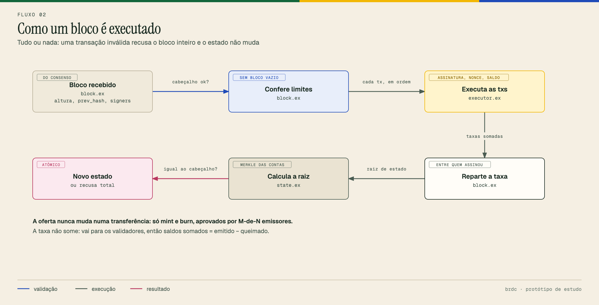

# Fluxo 02 — Como um bloco é executado

## Resumo
O ledger recebe um bloco decidido, confere o cabeçalho, executa as transações em ordem, reparte a taxa e confere a raiz de estado. É **tudo ou nada**: uma transação inválida recusa o bloco inteiro.

## Quem participa
- **Consenso (Fase 3):** entrega o bloco e quem assinou o certificado (`signers`).
- **`BrdcLedger.Block`:** valida limites e reparte a taxa.
- **`BrdcLedger.Executor`:** aplica cada transação.
- **`BrdcLedger.State`:** guarda contas, oferta e referências; calcula a raiz.

## Diagramas

## Passo a passo
1. Confere `height = altura atual + 1`, `prev_hash`, bloco **não vazio**, limites de transações e bytes, `signers` distintos e o proponente entre eles.
2. Para cada transação: mesma rede (`chain_id`), assinatura válida, `nonce` igual ao da conta, taxa ≥ mínima (ADR-0014), saldo cobre a taxa.
3. Executa o tipo: **transferência** (move saldo), **mint** (cria moeda), **burn** (destrói) ou **atestado de reserva**. Mint, burn e atestado exigem aprovações de M emissores sobre o documento exato (conta, valor e referência única; no atestado, sequência e total em reservas).
4. Soma as taxas e divide em partes iguais entre os `signers`; o resto vai para o proponente.
5. Calcula a raiz de estado e compara com a do cabeçalho; só então o estado novo vale.

## O que é verificado e por quem
- Assinatura, nonce, saldo, taxa e aprovações: `Executor`. Altura, limites e raiz: `Block`.
- Qualquer nó refaz tudo e chega à mesma raiz (determinismo).

## O que pode dar errado
- Transação inválida no meio do bloco: o bloco é recusado e o estado não muda.
- Atestado com sequência repetida ou pulada (`:bad_sequence`) ou sem M assinaturas.
- Mint repetido com a mesma referência (`:ref_used`) ou aprovação de outro valor (`:not_enough_approvals`).
- Replay: o nonce já usado é recusado.

## Onde está no código
`apps/brdc_ledger/lib/brdc_ledger/`: `tx.ex`, `params.ex`, `state.ex`, `executor.ex`, `block.ex`. Mapa: [Como ler o código da Fase 2](../concepts/11-reading-phase-2-code.md).

## Testes que cobrem
`ledger_test.exs` (mint/burn, replay, taxa, bloco atômico, raiz) e `properties_test.exs` (oferta = emitido − queimado = soma dos saldos em sequências aleatórias; determinismo).

## Limites honestos
- Um atestado falso assinado por M emissores é aceito: a chain não enxerga o banco. A confiança é nos emissores (ADR-0002).
- A chain só prova o que os emissores **atestam**; a reserva em reais vive fora (ADR-0002).
- Raiz de estado por Merkle simples; árvore esparsa e disco são o ADR-0012 (ainda proposto).
- O atestado de reserva é **declaração dos emissores**: a chain guarda o último (sequência crescente) e `State.coverage/1` compara com a oferta, só como informação. Subcobertura **não congela nada** (ADR-0009).
- Tudo em memória, sem rede e sem consenso.
