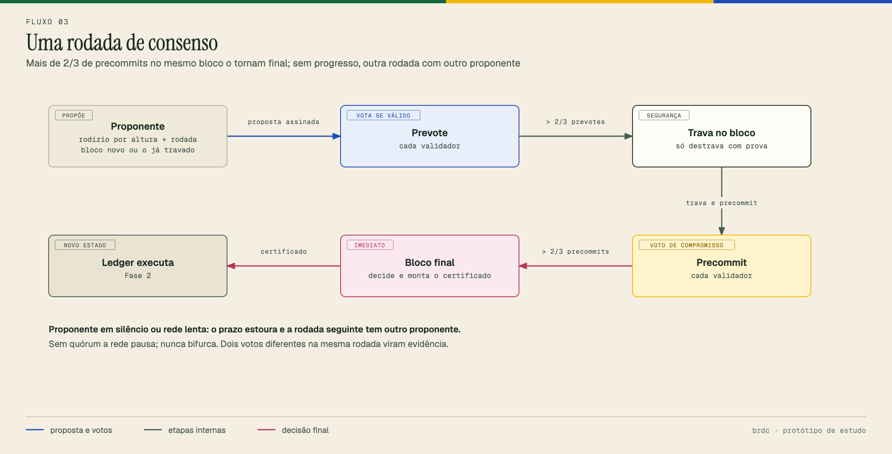

# Fluxo 03 — Uma rodada de consenso

## Resumo
Como os validadores concordam sobre o próximo bloco de uma altura: o proponente propõe, todos dão prevote, quem vê mais de 2/3 trava e dá precommit, e mais de 2/3 de precommits tornam o bloco **final**, com um certificado que qualquer um pode conferir.

## Quem participa
- **Validadores** (poder igual, [ADR-0013](../adr/0013-governance-of-issuers-and-validators.md)): cada um roda um `BrdcConsensus.Engine`.
- **Proponente:** muda a cada rodada, por rodízio `(altura + rodada) mod N`.
- **Quem roda o motor** (o nó, na Fase 4; o simulador, nos testes): entrega mensagens, dispara os prazos e executa as ações.
- **Ledger (Fase 2):** valida o bloco (`valid_fn`) e executa o bloco final.

## Diagramas

## Passo a passo
1. **Proposta:** o proponente da rodada entrega um bloco (`{:need_block, r}` → `{:block, bloco}`) e o motor o assina e envia. Se já está travado num bloco, repropõe esse.
2. **Prevote:** quem recebe a proposta confere proponente, assinatura, hash e validade, e vota no bloco (ou **nulo**). Quem está travado só vota em outro bloco com prova de uma rodada mais nova.
3. **Trava e precommit:** com mais de 2/3 de prevotes no mesmo bloco, o validador se **trava** nele e dá precommit. Com mais de 2/3 de prevotes nulos, dá precommit nulo.
4. **Decisão:** mais de 2/3 de precommits no mesmo bloco (em qualquer rodada): o bloco é final e o motor devolve `{:decide, bloco, certificado}`.
5. **Sem progresso:** os prazos de proposta, prevote e precommit passam para a rodada seguinte, com outro proponente. Se mais de 1/3 dos validadores já estão numa rodada mais nova, o motor salta para ela.
6. **Sem bloco vazio:** o motor só pede bloco (`:need_block`) quando o nó inicia a altura, e o nó só inicia com transação pendente.

## O que é verificado e por quem
- Cada mensagem: assinatura, validador do conjunto, altura e rede (`chain_id`): `Vote.valid?/2`, `Proposal.valid?/2`.
- O **certificado**: `Certificate.verify/3` confere quórum, votos únicos, assinaturas e que todos são do mesmo bloco, altura e rodada. Quem sincroniza confia no bloco **sem confiar em quem o entregou**.
- **Equivocação** (dois votos diferentes do mesmo validador na mesma rodada) vira `{:evidence, {voto_a, voto_b}}`; o segundo voto não conta.

## O que pode dar errado
- Proponente em silêncio: o prazo estoura e outra rodada começa.
- Partição ou menos de 2/3 vivos: **ninguém decide** (a rede pausa) e, quando cura, todos decidem o mesmo bloco.
- Mais de 1/3 bizantino: pode parar a rede; mais de 2/3 poderia decidir qualquer coisa (limite do desenho).
- Bloco que o ledger recusa: nunca recebe prevote, então nunca é decidido.

## Onde está no código
`apps/brdc_consensus/lib/brdc_consensus/`: `engine.ex` (motor), `vote.ex`, `proposal.ex`, `certificate.ex`, `sim.ex` (simulador determinístico). Mapa: [Como ler o código da Fase 3](../concepts/12-reading-phase-3-code.md).

## Testes que cobrem
`consensus_test.exs`: rede saudável, determinismo, proponente fora do ar, sem quórum, partição, equivocador, bloco inválido, evidência, mensagens falsas, certificado, e **propriedades** de segurança e de vivacidade. Um estresse manual de 4.800 execuções (n = 4 e 7, silencioso e equivocador, perda de 0 a 30%, partição) não achou nenhum caso com dois blocos finais.

## Limites honestos
- O motor decide **uma altura**; encadear alturas, **gossip/retransmissão**, **WAL** (disco) e **troca do conjunto de validadores** (ADR-0013) ficam para o nó e as fases seguintes.
- O simulador modela sincronia parcial (atraso e partição que cura); perda de mensagens só é usada em testes de segurança, porque o motor não retransmite.
- Equivocação gera evidência, mas **não há penalidade** (sem stake nesta fase).
- Algoritmo no desenho do Tendermint, implementação própria **sem auditoria nem prova formal**.
