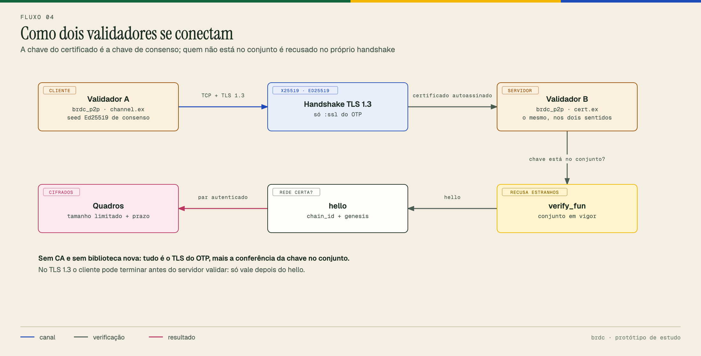

# Fluxo 04 — Como dois validadores se conectam

## Resumo
Dois validadores abrem uma conexão TCP, fazem TLS 1.3 com autenticação dos dois lados usando a chave de consenso como chave do certificado, e só se aceitam se a chave estiver no conjunto de validadores em vigor e a rede (`chain_id` + genesis) for a mesma.

## Quem participa
- **Validador cliente** (`Channel.connect/4`) e **validador servidor** (`Channel.listen/2` + `Channel.accept/3`).
- **Conjunto de validadores:** uma função consultada a cada conexão (a rotação do [ADR-0013](../adr/0013-governance-of-issuers-and-validators.md) vale sem reiniciar).

## Diagramas

## Passo a passo
1. Cada validador gera um certificado X.509 **autoassinado** a partir da sua semente Ed25519 (`Cert.generate/1`). Não há CA.
2. TCP + handshake **TLS 1.3** (`tlsv1.3`, `eddsa_ed25519`, `x25519`), com certificado dos dois lados.
3. O `verify_fun` confere, no evento do certificado autoassinado, que a chave pública do par **está no conjunto em vigor**; senão o handshake é recusado antes de qualquer dado.
4. Cada lado envia o **`hello`** (`chain_id` e hash do genesis) e confere o do outro. Rede ou genesis diferentes: `:wrong_network`.
5. Só então o par conta como autenticado (`conn.peer` é a chave de consenso dele).
6. Dados em **quadros** `tamanho(4 bytes) ‖ conteúdo`, com limite máximo conferido antes de ler o conteúdo e prazo de leitura.

## O que é verificado e por quem
- Chave do par no conjunto: `verify_fun` (nos dois sentidos).
- Rede e genesis: `check_hello/2`.
- Tamanho do quadro: `Frame.parse_header/2`; prazo: `:ssl.recv/3`.

## O que pode dar errado
- **Intruso** (chave fora do conjunto) ou **servidor impostor**: handshake recusado.
- Rede ou genesis diferentes: recusado no `hello`.
- Quadro gigante anunciado: conexão derrubada sem ler o conteúdo. Par calado: estouro de prazo.
- No TLS 1.3 o cliente pode terminar o `connect` antes de o servidor validar o certificado dele; por isso só o `hello` válido autentica.

## Onde está no código
`apps/brdc_p2p/lib/brdc_p2p/`: `cert.ex`, `channel.ex`, `frame.ex`. Decisão: [ADR-0015](../adr/0015-p2p-over-mutual-tls-1-3.md). Conceito: [P2P e canal seguro](../concepts/07-p2p-and-secure-channel.md).

## Testes que cobrem
`apps/brdc_p2p/test/brdc_p2p/channel_test.exs`: conversa entre dois validadores, cliente fora do conjunto, servidor impostor, rede e genesis diferentes, rotação do conjunto sem reiniciar, quadro gigante, par calado, certificado. Rodado 15 vezes seguidas sem falha.

## Limites honestos
- **Fatia da Fase 4:** ainda **não** há limites de conexão por IP/chave, pontos e banimento, registros de endereço assinados, descoberta, porta pública, `keygen`/`genesis` nem o roteiro de dois computadores. Estão **planejados**.
- A chave de consenso também assina o TLS (reuso de chave documentado no ADR-0015).
- Superfície X.509 do OTP; sem auditoria externa do nosso uso.
- Testado numa só máquina (localhost); entre computadores ainda não.
