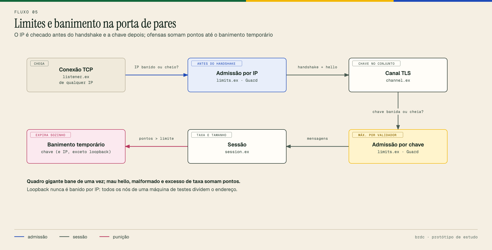

# Fluxo 05 — Limites e banimento na porta de pares

## Resumo
A porta de pares aceita só validadores, mas qualquer um pode tentar conectar. Esta camada limita quantas conexões cada IP e cada chave podem ter, mede mau comportamento em **pontos** e bane temporariamente quem passa do limite, sem nunca banir loopback por IP.

## Quem participa
- **`BrdcP2p.Limits`:** a política, **pura** (o tempo entra como argumento).
- **`BrdcP2p.Guard`:** processo que guarda o estado e o relógio.
- **`BrdcP2p.Listener`:** aceita conexões e aplica a ordem abaixo.
- **`BrdcP2p.Session`:** lê quadros aplicando taxa e tamanho e converte falhas em pontos.
- **`BrdcP2p.Rate`:** balde de fichas por sessão.

## Diagramas

## Passo a passo
1. Chega o TCP. O listener **admite o IP**: recusa se estiver banido, se o total de conexões estourou ou se o IP já tem o máximo (padrões: 64 no total, 8 por IP).
2. Handshake TLS com chave fixada e `hello` ([Fluxo 04](04-secure-channel.md)). Se falhar, o IP ganha pontos (`:handshake_failure` ou `:bad_hello`) e a vaga é liberada.
3. O listener **associa a chave** do validador: recusa se a chave estiver banida ou já tiver o máximo (padrão: 2).
4. O handler recebe a sessão. Cada leitura gasta uma ficha (padrão: 50/s, rajada de 100) e confere o tamanho do quadro.
5. Ofensas somam pontos: quadro gigante 100, `hello` errado 50, malformado 30, handshake falho 25, excesso de taxa 20, prazo estourado 10. Com **100 pontos** o sujeito é banido por 10 minutos; os pontos são esquecidos depois de 5 minutos sem ofensa.
6. Ao terminar (bem ou mal), a sessão é fechada e a vaga volta.

## O que é verificado e por quem
- Tetos e bans: `Limits.admit/3`, `Limits.bind_key/4`, `Limits.banned?/3`.
- Taxa: `Rate.take/3`. Tamanho: `Frame.parse_header/2` (e `Limits.max_size/1` por tipo de mensagem, para o gossip).
- **Loopback nunca é banido por IP** (`Limits.loopback?/1`): todos os nós de uma máquina de testes compartilham 127.0.0.1. A **chave** continua sujeita a ban.

## O que pode dar errado
- Um atacante com muitos IPs contorna o teto por IP; o teto **por chave** e o total ainda limitam, mas não impedem um ataque distribuído.
- Um validador honesto com bug pode se auto-banir por 10 minutos (o ban expira sozinho).
- Os pontos e bans ficam só em memória: reiniciar o nó os zera.

## Onde está no código
`apps/brdc_p2p/lib/brdc_p2p/`: `limits.ex`, `rate.ex`, `guard.ex`, `session.ex`, `listener.ex`.

## Testes que cobrem
`limits_test.exs` (tetos, pontos, ban e expiração, loopback, varredura; **propriedades**: tetos nunca ultrapassados e balde nunca passa da taxa) e `listener_test.exs` (teto por chave e por IP, vaga devolvida, quadro gigante bane a chave sem banir o loopback, intruso repetido não derruba ninguém, excesso de taxa). Rodados 20 vezes seguidas sem falha.

## Limites honestos
- Não é defesa completa contra DDoS (isso se faz também na rede, fora do nó).
- A porta **pública** (clientes) usa os mesmos mecanismos: [Fluxo 08](08-public-port.md).
- Registros de endereço e descoberta: [Fluxo 06](06-peer-discovery.md).
