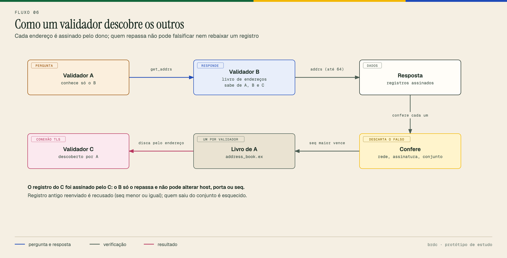

# Fluxo 06 — Como um validador descobre os outros

## Resumo
Cada validador assina um **registro de endereço** (`host:port`, com número de sequência) com a chave de consenso. Dois validadores conectados trocam os registros que conhecem, e cada um confere tudo sozinho. Assim a rede se mapeia sem lista central e sem confiar em quem repassa.

## Quem participa
- **Dono do endereço:** assina o próprio registro (`AddressRecord.sign/5`).
- **Quem repassa:** qualquer validador que já tem o registro; só o entrega.
- **Quem pergunta:** valida cada registro recebido e guarda no **livro de endereços** (`AddressBook`).

## Diagramas

## Passo a passo
1. Cada validador assina `(chain_id, validador, host, porta, seq)` (`AddressRecord`). `host` só aceita nome de máquina ou IP (letras, dígitos, `.`, `-`, `:`), até 253 bytes; a porta vai de 1 a 65535.
2. A conecta a um par que já conhece (o inicial vem de uma lista de partida) e manda `get_addrs`.
3. O par responde `addrs` com até **64** registros do livro dele.
4. A confere **cada** registro: mesma rede, assinatura válida, signatário **no conjunto de validadores em vigor** e `seq` **maior** que o guardado. O que falha é descartado; mensagem que nem decodifica vira ponto de mau comportamento.
5. A guarda um registro por validador e, para cada validador do conjunto que ainda não tem conexão, **disca** pelo endereço do registro (`AddressBook.dial_targets/3`).
6. Quem sai do conjunto (rotação, [ADR-0013](../adr/0013-governance-of-issuers-and-validators.md)) é esquecido (`AddressBook.prune/2`).

## O que é verificado e por quem
- Autoria do endereço: assinatura de quem é dono dele; ninguém fixa o endereço de outro validador.
- Atualidade: `seq` maior vence; registro antigo reenviado é `:stale`.
- Pertencimento: só validadores do conjunto em vigor.
- Tamanho: registro até 1 KiB, resposta até 64 registros.

## O que pode dar errado
- Um nó mentiroso **omite** registros: A pode demorar a descobrir alguém; perguntar a mais de um par resolve.
- Um validador cujo registro nunca circulou continua desconhecido até alguém o conhecer.
- Um registro válido apontando para um endereço que não atende só faz a discagem falhar (a identidade é conferida no TLS, então um endereço trocado por outro máquina não se passa pelo validador).
- O endereço é **público** para quem pergunta: revela onde os validadores estão (é a natureza de uma rede aberta aos pares do conjunto).

## Onde está no código
`apps/brdc_p2p/lib/brdc_p2p/`: `address_record.ex`, `address_book.ex`, `discovery.ex`.

## Testes que cobrem
`discovery_test.exs`: assinatura e adulteração (inclusive por **propriedade**: mudar um byte nunca gera outro registro válido), host e porta inválidos, livro (novo, atualizado, antigo, estranho, rede errada, impostor), mensagens (pedido, resposta, registro falso, lista grande, lixo, **propriedade** de que lixo nunca levanta exceção) e um teste **de ponta a ponta**: A só conhece B, pergunta a B, descobre C e disca para C pelo endereço assinado. Rodado 20 vezes seguidas sem falha.

## Limites honestos
- **Sem expiração** de registro: um validador que desaparece continua no livro até sair do conjunto.
- O livro fica **em memória**; o nó o reconstrói ao reconectar.
- A **lista de partida** (os primeiros pares) vem da gênese ([Fluxo 07](07-keygen-and-genesis.md)).
- A porta pública é o [Fluxo 08](08-public-port.md); o roteiro de dois computadores fica para a Fase 7.
