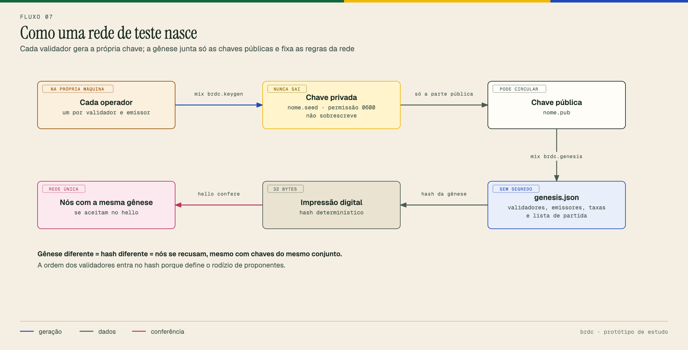

# Fluxo 07 — Como uma rede de teste nasce (keygen e gênese)

## Resumo
Cada validador e cada emissor gera a **própria chave** na própria máquina. Depois, um documento de **gênese** junta só as chaves públicas, as regras da rede e a lista de partida. A impressão digital da gênese entra no `hello` do canal: quem tem gênese diferente não entra.

## Quem participa
- **Operador de cada nó:** roda `mix brdc.keygen` na máquina dele; a chave privada **nunca sai** dela.
- **Quem monta a rede:** recebe as chaves públicas e roda `mix brdc.genesis`.
- **Todos os nós:** carregam o mesmo `genesis.json` e conferem o hash.

## Diagramas


## Passo a passo
1. **Chaves:** `mix brdc.keygen v1 --dir net` cria `net/v1.seed` (privada, permissão `0600`) e `net/v1.pub`. Recusa nome inválido e **nunca sobrescreve**. Repita para cada validador (`v1 v2 v3`) e emissor (`i1 i2`).
2. **Gênese:**
   ```
   mix brdc.genesis --chain-id brdc-devnet --validators v1,v2,v3 --issuers i1,i2 --threshold 2 \
     --peer v1=127.0.0.1:4001 --peer v2=127.0.0.1:4002 --dir net
   ```
   Grava `net/genesis.json` e imprime o hash. A **ordem** dos validadores define o rodízio de proponentes.
3. Cada nó lê o arquivo (`Genesis.from_json/1`), que **valida tudo de novo** e confere o hash gravado.
4. O nó deriva os parâmetros do ledger (`Genesis.ledger_params/1`) e a configuração do canal (`Genesis.channel_config/3`), que leva o hash da gênese para o `hello`.

## O que é verificado e por quem
- `Keygen.generate/2`: nome (`a-z`, `0-9`, `_`, `-`, até 32), ausência de arquivo anterior, permissão `0600` **antes** de escrever o segredo.
- `Keygen.load_seed/1`: recusa semente legível por grupo ou outros.
- `Genesis.new/1`: `chain_id`, 1 a 64 validadores distintos, 1 a 32 emissores distintos, limite M-de-N entre 1 e N, taxas e limites de bloco válidos, e que cada par da lista de partida seja um validador com host e porta válidos.
- `Genesis.from_json/1`: arquivo adulterado ou corrompido dá `:hash_mismatch`.
- No canal: gênese diferente é recusada no `hello` ([Fluxo 04](04-secure-channel.md)).

## O que pode dar errado
- Operador perde o `.seed`: o validador some (não há recuperação). Operador copia o `.seed` para outra máquina ou nuvem: quem o tiver **é** o validador.
- `.seed` com permissão aberta: o nó **recusa** iniciar com ele.
- Gênese diferente entre máquinas: os nós se recusam (é o comportamento desejado, mas a mensagem é só "rede errada").

## Onde está no código
`apps/brdc_node/lib/brdc_node/keygen.ex`, `genesis.ex` e `apps/brdc_node/lib/mix/tasks/brdc.keygen.ex`, `brdc.genesis.ex`.

## Testes que cobrem
`keygen_test.exs` (permissão 0600, não sobrescreve, nomes inválidos, semente aberta recusada, semente fora do resultado) e `genesis_test.exs` (ida e volta, qualquer campo muda o hash, ordem muda o hash, validações, arquivo adulterado, sem segredo, parâmetros derivados, **propriedade**: lixo nunca levanta exceção). As tarefas também foram executadas de verdade numa pasta temporária.

## Limites honestos
- A chave privada fica **em arquivo no disco**, sem criptografia: é uma rede de teste. Chave de validador de produção pediria HSM ou cofre.
- Na BEAM não há zeroização de memória.
- A gênese **não tem** tempo de bloco nem alocação inicial de saldos: a moeda só nasce por mint dos emissores. O tempo de agrupamento (P3) ainda é decisão pendente.
- A lista de partida é só um ponto de entrada; a descoberta ([Fluxo 06](06-peer-discovery.md)) faz o resto.
