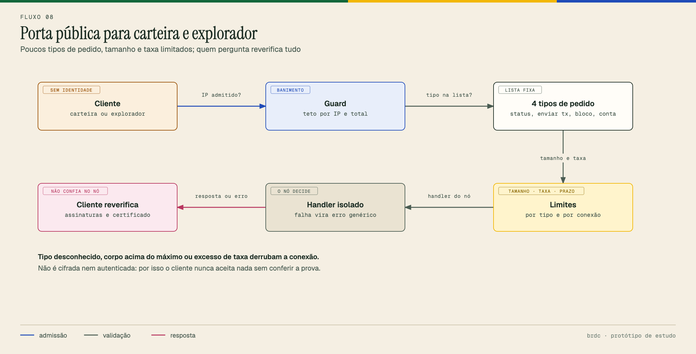

# Fluxo 08 — Porta pública para carteira e explorador

## Resumo
É por onde a carteira e o explorador falam com a rede. Ao contrário da porta de pares, **não exige identidade**, então é **enxuta e muito limitada**: poucos tipos de pedido, tamanho e taxa limitados, e quem pergunta **reverifica tudo**.

## Quem participa
- **Cliente:** a carteira web, o explorador ou uma ferramenta.
- **`BrdcP2p.PublicPort`:** aceita, limita e responde.
- **`BrdcP2p.Guard`:** teto de conexões por IP e total, e banimento.
- **Handler do nó:** decide o conteúdo (chega nas fases do nó e da carteira).

## Diagramas

## Passo a passo
1. O cliente abre TCP. O `Guard` admite o IP (teto por IP e total; ban).
2. Cada pedido é um quadro `tamanho ‖ tipo(1 byte) ‖ corpo`. Os tipos aceitos são só **1 status, 2 enviar transação, 3 ler bloco, 4 ler conta**.
3. O tamanho do corpo é limitado **por tipo** (16 B, 64 KiB, 16 B, 64 B) e o quadro inteiro por um teto global; a taxa é limitada por conexão (balde de fichas).
4. O `handler` do nó responde `{:ok, corpo}` ou `{:error, motivo}`. Se ele **falhar**, o cliente recebe o erro genérico `internal` e a conexão continua.
5. Resposta: `<<0, corpo>>` (ok) ou `<<1, motivo>>` (erro).
6. Tipo desconhecido, corpo acima do máximo, quadro gigante ou excesso de taxa **derrubam a conexão** (e somam pontos); inatividade acima do prazo também fecha.

## O que é verificado e por quem
- Lista de tipos fixa e tamanhos por tipo: `PublicPort`.
- Tetos e ban: `Guard`/`Limits` (loopback nunca é banido por IP).
- **O conteúdo da resposta não é verificado pelo nó**: o cliente confere assinaturas, o certificado de commit e as provas.

## O que pode dar errado
- A porta **não é cifrada nem autenticada**: quem estiver no caminho lê o que o cliente pergunta (ex.: saldo de um endereço). Para uso real, passa por HTTPS na frente (o servidor da carteira).
- Um nó mentiroso pode **omitir** ou atrasar respostas; o cliente o detecta quando reverifica, e consulta outro nó.
- Ataque distribuído (muitos IPs) contorna o teto por IP (ver [Fluxo 05](05-limits-and-bans.md)).

## Onde está no código
`apps/brdc_p2p/lib/brdc_p2p/public_port.ex` (usa `guard.ex`, `limits.ex`, `rate.ex`, `frame.ex`).

## Testes que cobrem
`public_port_test.exs`: os 4 tipos, handler que falha, tipo desconhecido, corpo acima do máximo, quadro gigante, teto por IP, excesso de taxa, inatividade e a lista fixa de tipos. Rodado 60 vezes seguidas sem falha.

## Limites honestos
- O `handler` real (estado, mempool, blocos) **ainda não existe**: é o nó (`brdc_node`). Aqui só o contêiner seguro.
- Sem cifra e sem autenticação (ADR-0007/0015); o cliente é quem protege a si mesmo.
- Os pedidos de leitura ainda **não têm prova** embutida: elas chegam com o nó.
