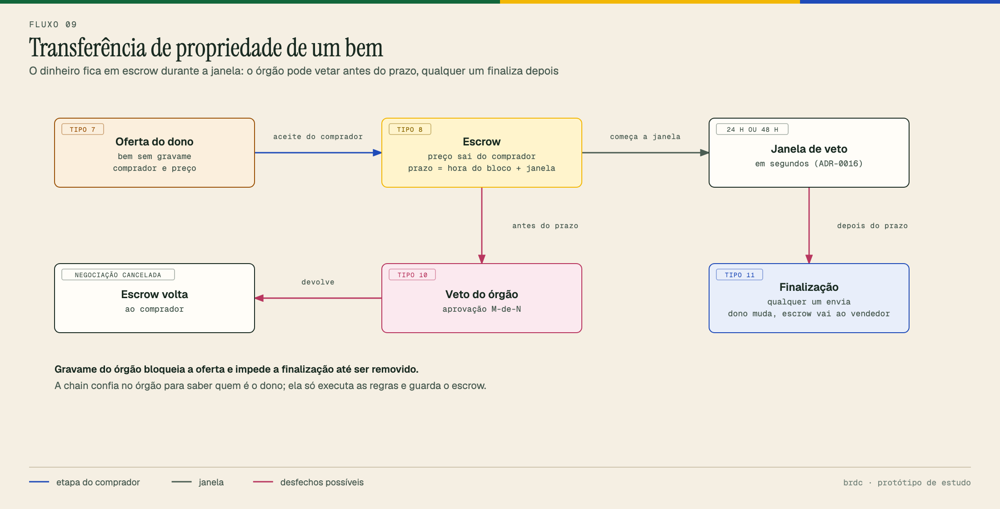

# Fluxo 09 — Transferência de propriedade de um bem

## Resumo
Um bem (imóvel, veículo…) pertence a um endereço. Para vendê-lo, o dono faz uma oferta, o comprador aceita colocando o preço em **escrow**, e abre-se uma **janela de veto** em segundos. Nela, o órgão da classe pode vetar (o escrow volta). Passado o prazo, qualquer um finaliza: a propriedade passa ao comprador e o escrow vai ao vendedor.

## Quem participa
- **Autoridades raiz** (gênese): criam classes de bens. Distintas de emissores e validadores ([ADR-0018](../adr/0018-assets-direct-trade-with-veto-window.md)).
- **Órgão da classe** (M-de-N): registra bens, veta negociações, põe e tira gravames.
- **Dono / vendedor** e **comprador:** os dois lados da negociação.
- **Qualquer pessoa:** pode enviar a finalização depois do prazo.

## Diagramas

## Passo a passo
1. **Classe (tipo 5):** as autoridades raiz aprovam (M-de-N) a classe: id, órgão (chaves e limite) e janela de veto, entre o mínimo e o máximo da gênese.
2. **Registro (tipo 6):** o órgão aprova o bem: `asset_id` único, dono inicial, metadado (até 256 bytes, normalmente um hash do documento).
3. **Oferta (tipo 7):** só o dono, sem gravame e sem negociação em curso: comprador e preço.
4. **Aceite (tipo 8):** só o comprador. O preço sai do saldo dele para o **escrow** e o prazo vira `horário do bloco + janela da classe`.
5. **Veto (tipo 10):** aprovação M-de-N do órgão, **só antes do prazo**. O escrow volta ao comprador e a negociação acaba.
6. **Finalização (tipo 11):** qualquer um, **só depois do prazo**, e só sem gravame. A propriedade passa ao comprador e o escrow vai ao vendedor.
7. **Cancelamento (tipo 9):** só o dono, **só antes do aceite**.
8. **Gravames (tipos 12 e 13):** o órgão adiciona e remove (penhora, alienação fiduciária…). Com gravame o bem não pode ser ofertado e uma negociação não finaliza.

## O que é verificado e por quem
- Aprovações M-de-N: `BrdcLedger.Approvals` (chaves distintas do conjunto autorizado, assinaturas válidas).
- Cada aprovação do órgão assina um documento com a **revisão** (`rev`) do bem, que sobe a cada ação do órgão: **uma aprovação nunca vale duas vezes**. O veto também amarra comprador, preço e prazo.
- Regras de estado (dono, comprador, status, janela, gravame, saldo): `BrdcLedger.Assets`.
- Taxas (ADR-0014): classe e registro 0,05 BRDC; cada etapa 0,02; ações do órgão sem mínimo.
- Conservação: `saldos + escrow = emitido − queimado` (as taxas são repartidas pelo bloco).

## O que pode dar errado
- **Órgão comprometido** (M assinaturas): registra bens falsos ou veta à vontade. A chain não sabe se o bem existe nem quem é o dono de verdade.
- **Disputa entre as partes:** a chain não arbitra; só o órgão tem veto e gravames.
- O comprador fica com o dinheiro **preso** durante a janela (24 h ou 48 h por padrão).
- Gravame colocado durante a janela trava a finalização até ser removido (ou o órgão vetar).
- Se ninguém enviar a finalização depois do prazo, o escrow continua preso: é preciso que alguém a envie.

## Onde está no código
`apps/brdc_ledger/lib/brdc_ledger/assets.ex` (regras e documentos aprovados), `approvals.ex`, `state.ex` (classes, bens, negócios, escrow e raiz) e `executor.ex` (tipos 5 a 13).

## Testes que cobrem
`assets_test.exs`: classe e registro (aprovações, duplicados, limites), negociação completa com prazo, autorização de cada etapa, cancelamento, veto (dentro e fora da janela, aprovação amarrada à negociação), gravames (bloqueios, aprovação não reaproveitável), taxas, cargas malformadas, bloco real com taxas repartidas e **propriedade** de conservação do escrow em sequências aleatórias.

## Limites honestos
- Sem arbitragem, sem leilão, sem condições além do veto e dos gravames.
- O horário vem do bloco ([ADR-0016](../adr/0016-block-time-and-windows-in-seconds.md)): o proponente pode deslocá-lo em segundos.
- Credenciais e contratos entre partes são as próximas etapas da Fase 5.
