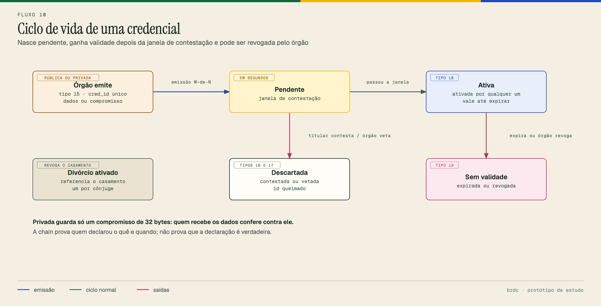

# Fluxo 10 — Credenciais (CNH, identificação, casamento e divórcio)

## Resumo
Um **órgão** declara algo sobre uma pessoa (ela tem tal CNH; casou; divorciou). A declaração nasce **pendente**, tem uma **janela de contestação** em segundos, depois fica **ativa** até expirar ou ser **revogada**. Pode ser **pública** (os dados ficam na chain) ou **privada** (só um compromisso de 32 bytes).

## Quem participa
- **Autoridades raiz** (gênese): criam os **tipos** de credencial.
- **Órgão do tipo** (M-de-N): emite, veta e revoga.
- **Titular:** o endereço sobre o qual a credencial fala; pode contestar.
- **Qualquer pessoa:** ativa a credencial depois da janela e a consulta.

## Diagramas

## Passo a passo
1. **Tipo (tipo de tx 14):** as autoridades raiz aprovam (M-de-N) o tipo: id, órgão (chaves e limite), janela de contestação, validade (`0` = não expira), privacidade e, se couber, a referência a outro tipo.
2. **Emissão (15):** o órgão aprova a credencial: `cred_id` único, titular, dados (público, até 512 bytes) ou compromisso (privado, 32 bytes) e a referência, se o tipo exige. Nasce **pendente**; `ativa em = horário do bloco + janela` e `expira em = horário + validade`.
3. **Contestação (16):** só o **titular**, só dentro da janela: a credencial é descartada.
4. **Veto (17):** o órgão (M-de-N), só dentro da janela: a credencial é descartada.
5. **Ativação (18):** qualquer um, **só depois** do prazo.
6. **Revogação (19):** o órgão (M-de-N), de uma credencial pendente ou ativa. Definitiva.
7. **Consulta:** `State.credential_valid?/3` diz se está ativa e não expirou.

### Casamento e divórcio
- **Casamento:** uma credencial **por cônjuge**, tipo privado e sem validade.
- **Divórcio:** tipo privado que **referencia** o casamento do **mesmo titular** (precisa estar **ativo**) e, ao ser **ativado**, **revoga** esse casamento. Um divórcio vetado ou contestado **não** revoga nada.
- Cada cônjuge tem o seu divórcio; o de um não revoga o casamento do outro.

## O que é verificado e por quem
- Aprovações M-de-N (`Approvals`): cada documento aprovado amarra os campos que importam (titular, dados, referência, motivo); trocar um deles invalida a aprovação.
- `cred_id` único **para sempre** (mesmo contestada, vetada ou revogada fica a entrada): uma aprovação nunca emite duas vezes.
- Regras de estado, janela, referência e privacidade: `BrdcLedger.Credentials`.
- Taxas (ADR-0014): emissão e revogação 0,01 BRDC; tipo 0,05; o resto sem mínimo.

## O que pode dar errado
- **Órgão comprometido** (M assinaturas): emite credenciais falsas ou revoga as verdadeiras. A chain só prova a autoria.
- **Privada não é anônima:** o compromisso e o endereço do titular são públicos; só o conteúdo fica fora.
- **Sem nome real na chain:** a ligação entre endereço e pessoa é do órgão, fora da chain.
- A chain **não verifica** que duas credenciais de casamento são do mesmo casal.
- A validade é **lida**, não executada: quem consulta confere o horário.
- Se ninguém ativar a credencial depois do prazo, ela segue pendente (e não vale).

## Onde está no código
`apps/brdc_ledger/lib/brdc_ledger/credentials.ex` (regras, documentos aprovados, cargas), `state.ex` (tipos, credenciais e raiz), `executor.ex` (tipos 14 a 19). Decisão: [ADR-0019](../adr/0019-credentials-with-contest-window-and-revocation.md).

## Testes que cobrem
`credentials_test.exs`: tipos (aprovações, limites, duplicado, referência, sem autoridade), emissão com janela e validade, público até 512 e privado exatamente 32 bytes, aprovações amarradas, contestação, veto, revogação, casamento por cônjuge e divórcio (referência ativa do mesmo titular, vetado não revoga, casamento já revogado), taxas, cargas malformadas e **propriedade** (ids únicos, só ativo é válido, divórcio ativo sempre deixa o casamento revogado).

## Limites honestos
- O órgão é a fonte de verdade; sem arbitragem.
- Privacidade por compromisso simples (hash com sal): sem prova de conhecimento zero.
- Contratos entre partes são a próxima etapa da Fase 5.
