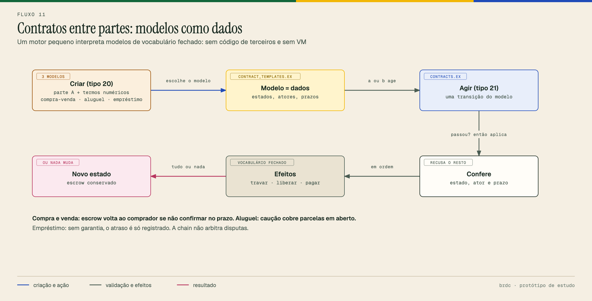

# Fluxo 11 — Contratos entre partes (compra e venda, aluguel, empréstimo)

## Resumo
Duas partes combinam termos numéricos e o dinheiro anda por **regras fixas**, com escrow quando faz sentido. Os modelos são **dados** (estados, quem age, prazos, efeitos); um motor pequeno os interpreta com um **vocabulário fechado**. Não há máquina virtual nem código de terceiros ([ADR-0004](../adr/0004-native-contracts-and-declarative-templates.md), [ADR-0017](../adr/0017-initial-contract-catalog.md)).

## Quem participa
- **Parte A:** cria o contrato (vendedor, locador ou credor).
- **Parte B:** a outra (comprador, locatário ou devedor).
- **Qualquer pessoa:** em transições marcadas `:any` (ex.: liquidar depois do prazo).

## Diagramas

## Passo a passo
1. **Criar (tipo 20):** `modelo`, `contract_id` único, endereço da parte B e **termos** (números, em ordem fixa por modelo). O motor valida os termos e já aplica os efeitos iniciais (no empréstimo, o credor **trava o principal**).
2. **Agir (tipo 21):** `contract_id` e o nome da transição. O motor confere, nesta ordem: o contrato existe; a transição existe no modelo; o **estado** é o esperado; o **ator** é o certo; as **condições de tempo** valem (horário do bloco, [ADR-0016](../adr/0016-block-time-and-windows-in-seconds.md)). Só então aplica os **efeitos em ordem**; se algum falhar, nada muda.
3. **Efeitos possíveis:** travar (da conta para o escrow do contrato), liberar (do escrow para uma conta), pagar direto (sem escrow), definir ou incrementar uma variável.

### Os três modelos
| Modelo | Termos | Caminho feliz | Se der errado |
|---|---|---|---|
| **compra-venda** | preço, duração | B aceita (preço vai ao escrow) → B confirma → escrow vai ao vendedor | passou o prazo sem confirmação: qualquer um devolve o escrow ao comprador; A pode devolver antes; A cancela antes do aceite |
| **aluguel** | parcela, período (s), nº de parcelas, caução, tolerância (s) | B aceita (caução no escrow) → paga as parcelas direto a A → depois do prazo + tolerância qualquer um liquida: a caução volta a B | parcelas em aberto saem da caução (até o valor dela) para A, o resto volta a B; A libera antes do prazo só com tudo pago |
| **empréstimo** | principal, valor a devolver, duração | A cria (principal travado) → B aceita e recebe → B devolve o valor combinado a A | A cancela antes do aceite e recupera o principal; passou o prazo: o atraso é **só registrado** (`mark_default`), sem garantia |

## O que é verificado e por quem
- Termos válidos (`sane_terms?`): preço e parcela positivos, duração dentro dos limites da gênese, parcelas entre 1 e 1200, sem estouro de 64 bits.
- Estado, ator, condições e efeitos: `BrdcLedger.Contracts`.
- Os modelos só usam o **vocabulário fechado**: um teste percorre todos e falha se aparecer um estado, ator, condição, efeito ou expressão desconhecidos.
- Taxa (ADR-0014): cada passo 0,01 BRDC.
- Conservação: o escrow global é a soma dos escrows dos contratos, e contrato terminado tem escrow zero.

## O que pode dar errado
- **Sem arbitragem:** se as partes discordam (o comprador diz que não recebeu, o vendedor diz que entregou), a chain só aplica as regras; o desenho favorece quem pagou (escrow volta ao comprador no prazo).
- **Empréstimo sem garantia:** o atraso é registrado, mas nada é cobrado automaticamente; juros precisam estar dentro do valor combinado.
- **Aluguel sem rescisão antecipada:** só termina no prazo (ou com tudo pago e o locador liberando).
- Sem juros automáticos, multas, correção monetária ou oráculos (podem virar modelos novos por ADR).
- Um contrato **não substitui** o contrato jurídico; é a execução automática do que as partes combinaram.

## Onde está no código
`apps/brdc_ledger/lib/brdc_ledger/contract_templates.ex` (os modelos, como dados e com o vocabulário documentado), `contracts.ex` (o motor), `state.ex` (contratos e raiz) e `executor.ex` (tipos 20 e 21).

## Testes que cobrem
`contracts_test.exs`: cada modelo do início ao fim, as recusas (ator, estado, prazo, saldo, termos, duplicado), a conferência do vocabulário fechado, a taxa, cargas malformadas e uma **propriedade** de conservação do escrow em sequências aleatórias dos três modelos.

## Limites honestos
- O motor é novo e pequeno, sem auditoria.
- Os termos são só numéricos: sem texto livre e sem anexos.
- A Fase 5 termina aqui; credenciais e bens ligados a contratos (ex.: vender um bem registrado dentro de um contrato) não existem, porque a venda de bens tem o fluxo próprio do [Fluxo 09](09-asset-trade.md).
