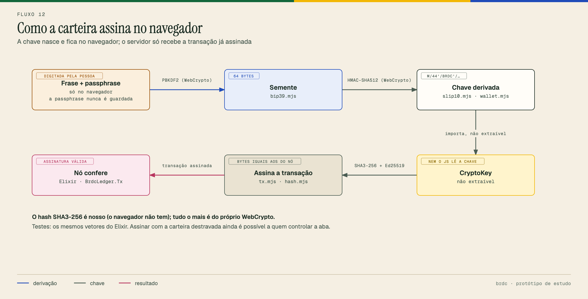

# Fluxo 12 — Como a carteira assina no navegador

## Resumo
A frase e a passphrase são digitadas no navegador, viram uma chave de assinatura **não extraível** e assinam a transação **ali mesmo**. O servidor só recebe a transação pronta. Toda a criptografia usa o `crypto.subtle` do próprio navegador; o único primitivo escrito por nós é o SHA3-256 ([ADR-0020](../adr/0020-browser-crypto-webcrypto-without-dependencies.md)).

## Quem participa
- **Pessoa:** digita a frase e, se usa, a passphrase ([ADR-0021](../adr/0021-vault-never-stores-passphrase.md), proposto: a passphrase nunca é guardada).
- **Módulos JS** (`apps/brdc_web/assets/js/crypto/`): `bip39.mjs`, `slip10.mjs`, `wallet.mjs`, `tx.mjs`, `hash.mjs`, `keccak.mjs`, `bech32m.mjs`, `bytes.mjs`.
- **Nó (Elixir):** `BrdcLedger.Tx` confere a assinatura.

## Diagramas

## Passo a passo
1. A frase é validada (palavras da lista, tamanho, checksum SHA-256) por `mnemonicToEntropy`.
2. Semente de 64 bytes: PBKDF2-HMAC-SHA512 do WebCrypto (`bip39.mjs`). A passphrase entra aqui.
3. Chave filha por SLIP-10 (`slip10.mjs`), caminho `m/44'/1112687683'/conta'/0'/índice'`, com HMAC-SHA512 do WebCrypto.
4. A semente da chave é importada duas vezes no WebCrypto (`wallet.mjs`): a primeira, extraível por um instante, só para ler a chave pública; a segunda, definitiva, **não extraível**. Os bytes são zerados (no melhor esforço).
5. Endereço: `bech32m("brdc", SHA3-256(tag "brdc/addr", chave pública))`.
6. A transação (`tx.mjs`) é montada com os **mesmos bytes** do Elixir; a assinatura é Ed25519 do WebCrypto sobre `SHA3-256(tag "brdc/tx", bytes assinados)`; o id é o hash etiquetado do conteúdo completo.
7. A transação assinada vai ao nó, que a confere.

## O que é verificado e por quem
- **Concordância com o Elixir:** os mesmos vetores (`vectors/crypto.json`, `hash.json`, `tx.json`) são conferidos pelos testes do JS e do Elixir. O Ed25519 é determinístico, então "o JS gera os mesmos bytes e a mesma assinatura" prova que o nó aceita o que a carteira assina.
- **Valores grandes:** valores chegam a 2⁶⁴−1 e `Number` do JavaScript perde precisão acima de 2⁵³. `bytes.mjs` **recusa** `Number` impreciso (use `BigInt` ou texto) em vez de arredondar em silêncio.
- **Frase:** o checksum acusa palavra trocada. A **passphrase não é verificável** (qualquer uma abre uma carteira válida): a tela vai mostrar o endereço resultante.

## O que pode dar errado
- **Carteira destravada + XSS ou extensão maliciosa:** pode **assinar** (não pode ler a chave, porque é não extraível). Mitigação: CSP estrita (já ativa), sem scripts de terceiros, aviso do que está sendo assinado.
- **Navegador antigo** (antes de Chrome 137, Firefox 129 e Safari 17): sem Ed25519 no WebCrypto; a carteira avisa e não funciona.
- **SHA3-256 próprio sem auditoria externa:** mitigado por vetores NIST, 1.000 entradas aleatórias contra o SHA-3 do Node e todos os tamanhos do vetor do Elixir.
- **Contexto seguro:** o `crypto.subtle` só existe em HTTPS ou `localhost`.
- Sem zeroização garantida de memória em JavaScript.

## Onde está no código
`apps/brdc_web/assets/js/crypto/*.mjs`; testes em `crypto.test.mjs` (`make js-test`); vetores do Elixir gerados por `tools/gen_wallet_vectors.exs`; lado do nó em `apps/brdc_crypto/test/brdc_crypto/hash_vectors_test.exs` e `apps/brdc_ledger/test/brdc_ledger/wallet_vectors_test.exs`.

## Testes que cobrem
18 testes JS (NIST, concordância com o Elixir, bech32m, BIP-39, SLIP-10, contas e passphrase, chave não extraível, endereço, transações byte a byte, limites de inteiros) e 5 testes Elixir sobre os mesmos vetores.

## Limites honestos
- Ainda **não há tela** que use esses módulos: só a criptografia está pronta e testada. O cofre cifrado (AES-GCM) e as telas (criar, importar, enviar) são os próximos passos da Fase 6.
- Só transferências estão nos vetores; os tipos de bens, credenciais e contratos (e as aprovações M-de-N) entram junto das telas.
